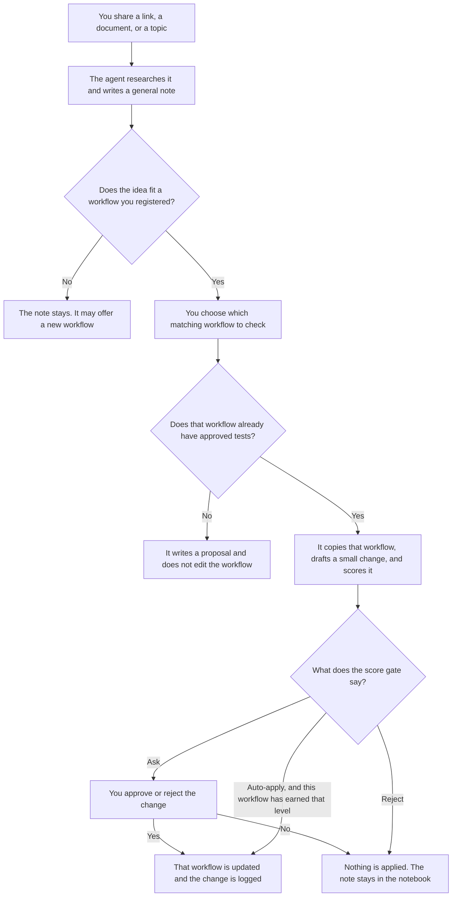

# Upskilling Agent

The Upskilling Agent studies new material (a doc, a link, a video, or a topic) and writes what it learned into a notebook. Those notes are general: a later question can use an idea even when no workflow was changed.

A change is narrower. The agent applies an idea only to a registered workflow the idea actually fits, then measures that change before it lands. It does not rewrite every workflow, and it does not keep a separate file of universal rules. If the idea fits nothing you already run, it stays in the notebook. The agent may offer to make a new workflow from it. Every applied change can be undone.

A workflow is any repeatable way of working you register: a skill, a prompt, an agent, a plugin, a documentation pipeline, or another process you want kept current. A skill is one kind of workflow, not the only kind.

The notebook folder is named `upskill-wiki`. That name is how the agent finds your notes. The agent itself is this folder, `upskilling-agent`.

## What you do



Say **"Get me started"** the first time. After that:

1. Say **"Learn about …"** and paste a link, a file, or a topic. The note is saved whether or not anything changes.
2. If the idea fits none of your registered workflows, the agent says so. Asking it to apply the idea anyway does not override that. The note remains available for a later question or a new workflow.
3. If it fits one or more workflows, you pick which to check. The agent does not edit one until you pick it, and it checks each workflow separately.
4. With starter tests, it drafts and scores a change to that workflow, then asks you. Say **"expand my tests"** before it may apply a clear improvement on its own.
5. Say **"What did I learn about …?"**, **"Show the changelog"**, **"Undo the last change"**, or **"Lint my wiki"** at any time.

## What you can register

The same note can fit more than one workflow. Each example below is a separate check. A refusal in one category does not delete the note.

| Category | What you register | An idea it might learn | A change it might try | What it leaves alone |
|---|---|---|---|---|
| Skill | A `SKILL.md` workflow, such as a documentation review | A metadata schema can catch a missing field before a person reviews the prose | Add an optional check that runs only when that skill's repository already has a schema | Rewriting the skill to judge writing quality, which the schema cannot do |
| Prompt | A reusable prompt file, such as a code-review prompt | A language release adds one failure mode reviewers keep missing | Add that check to the prompt, then score reviews against cases that should catch it | Adding the check to every prompt you own |
| Agent | An agent definition, such as a research agent | Source pages sometimes contain instructions aimed at the agent | Tell that agent to treat those lines as untrusted data and keep reading | Changing a coding agent that never reads outside pages |
| Plugin | A plugin folder, such as a documentation checker | A citation check can tell when a quoted source line has changed | Add that check beside the plugin's existing validators | Turning the plugin into a prose grader |
| Documentation pipeline | A repeatable docs flow, such as draft, review, then publish | Structural checks belong before editorial review | Stop the pipeline when required front matter is missing, and leave the writing review to the later stage | Replacing the human review stages with one automated score |
| Another repeatable process | A checklist or template you run often, such as release notes | Each release note should name the user-facing change, not only the commit | Add that requirement to the template and test it on a note that omits the user impact | Applying the release-note rule to a meeting agenda |

## Files that ship with the agent

These files are the agent. They are not created per learning session.

| File | What it does |
|---|---|
| [agents/upskilling-agent.md](agents/upskilling-agent.md) | Runs the whole loop and stops when a concept does not fit, or when a change needs your approval. |
| [skills/upskilling-agent/SKILL.md](skills/upskilling-agent/SKILL.md) | Entry point. Starts learning, answers questions from the notebook, and sends a bad fit back before any edit. |
| [skills/quickstart/SKILL.md](skills/quickstart/SKILL.md) | First run: creates the notebook, finds workflows you can register, and drafts starter tests. |
| [skills/wiki-setup/SKILL.md](skills/wiki-setup/SKILL.md) | Creates the notebook or registers one more workflow at propose-only. |
| [skills/ingest/SKILL.md](skills/ingest/SKILL.md) | Reads the material, checks it against other sources, and writes source notes and concept pages. See [how sources are handled](skills/ingest/references/source-handling.md). |
| [skills/triage/SKILL.md](skills/triage/SKILL.md) | Scores each general concept against your registered workflows. A `no` is not turned into a change. |
| [skills/eval-bootstrap/SKILL.md](skills/eval-bootstrap/SKILL.md) | Drafts the test cases you approve. See [the case format](skills/eval-bootstrap/references/case-format.md). |
| [skills/eval-run/SKILL.md](skills/eval-run/SKILL.md) | Runs each case several times and scores the saved outputs. |
| [skills/adapt/SKILL.md](skills/adapt/SKILL.md) | Copies one matching workflow, drafts the change, and applies it only after the gate. See [the report it shows you](skills/adapt/references/report-template.md). |
| [skills/changelog/SKILL.md](skills/changelog/SKILL.md) | Shows what changed and how to undo it. |
| [skills/wiki-lint/SKILL.md](skills/wiki-lint/SKILL.md) | Finds stale, unverified, or contradictory notes. |
| [skills/model-upgrade/SKILL.md](skills/model-upgrade/SKILL.md) | Re-checks the notebook and the tests after a new model. |
| [scripts/upskilling-agent.py](scripts/upskilling-agent.py) | The checks that do not depend on the model: snapshots, scoring, the gate, apply, and undo. |
| [tests/smoke_test.py](tests/smoke_test.py) | Tests that script. It does not test the model's reading or drafting. |
| [.claude-plugin/plugin.json](.claude-plugin/plugin.json) | Plugin name and description for a host that loads this folder as a plugin. |

The notebook starts from these templates. `init` copies a template only when that file is not already in your notebook, so it will not overwrite notes you already have.

| Template | Becomes |
|---|---|
| [wiki-template/schema.md](wiki-template/schema.md) | The rules the agent reads before it does anything. |
| [wiki-template/index.md](wiki-template/index.md) | The generated list of concept pages. |
| [wiki-template/backlog.md](wiki-template/backlog.md) | Topics still worth learning or testing. |
| [wiki-template/journal.md](wiki-template/journal.md) | The dated log. |
| [wiki-template/autonomy.json](wiki-template/autonomy.json) | Which workflows are registered, and what each one is allowed to do. |
| [wiki-template/config.json](wiki-template/config.json) | Notebook scope. Version 1 is personal. |

## Files the agent creates

It creates these under `upskill-wiki/`, next to this folder or in a parent folder. Your existing workflow files are separate. The agent reads them, and it edits one live workflow only after you approve or the gate allows it.

### When the notebook is created

| Created file | What it does |
|---|---|
| `upskill-wiki/schema.md` | Copy of [wiki-template/schema.md](wiki-template/schema.md). Edit this if you want to change the agent's rules. |
| `upskill-wiki/index.md` | Rebuilt from the concept pages. Do not edit it by hand. |
| `upskill-wiki/backlog.md` | Follow-ups the agent noticed, plus anything you add. |
| `upskill-wiki/journal.md` | One line per learning session, change, or undo. |
| `upskill-wiki/autonomy.json` | The level of each registered workflow. |
| `upskill-wiki/config.json` | Scope and the date the notebook was created. |
| `upskill-wiki/sources/` | Empty until something is read. |
| `upskill-wiki/concepts/` | Empty until a general idea is written up. These notes are not tied to one workflow. |
| `upskill-wiki/workflow-map/` | Empty until a workflow is registered. |
| `upskill-wiki/evals/` | Empty until a workflow has tests. |
| `upskill-wiki/changelog/snapshots/` | Empty until a change is drafted. |

### When you register a workflow

| Created or updated file | What it does |
|---|---|
| `upskill-wiki/autonomy.json` | Adds the workflow at Level 0, propose only. |
| `upskill-wiki/workflow-map/<workflow>.md` | What the workflow is for, and which concepts might affect it. |
| `upskill-wiki/evals/<workflow>/` | Folder for that workflow's tests. |

The workflow's own files, such as a skill's `SKILL.md` or a prompt file, already exist. Registering does not copy or edit them.

### When it learns something

| Created or updated file | What it does |
|---|---|
| `upskill-wiki/sources/src-<slug>.md` | One note per source: what it claimed, how trustworthy it is, and whether it tried to instruct the agent. |
| `upskill-wiki/concepts/<slug>.md` | One general idea per page, with a confidence level and the sources it came from. |
| `upskill-wiki/index.md` | Regenerated so the new pages can be found. |
| `upskill-wiki/journal.md` | A line for the learning session. |
| `upskill-wiki/backlog.md` | Claims that still need checking. |

### When a workflow is tested

| Created file | What it does |
|---|---|
| `upskill-wiki/evals/<workflow>/train.json` | Approved cases the change may be tuned against. |
| `upskill-wiki/evals/<workflow>/heldout.json` | Cases kept back so a change cannot be tuned to every test. |
| `upskill-wiki/evals/<workflow>/outputs/<label>/<case>/runN.txt` | The text that workflow produced on that run. |
| `upskill-wiki/evals/<workflow>/results-<label>.json` | Pass or fail for each check. `baseline` is the current workflow. `candidate` is the draft. |
| `upskill-wiki/evals/<workflow>/pending-<label>.json` | Rubric checks still waiting for a separate judgment. Removed from use once judging finishes. |
| `upskill-wiki/evals/<workflow>/rubric-<label>.json` | The yes or no judgments for those rubric checks. |

### When a change is drafted

| Created file | What it does |
|---|---|
| `upskill-wiki/changelog/snapshots/<change-id>/before/` | Exact copy of that workflow before the draft. |
| `upskill-wiki/changelog/snapshots/<change-id>/candidate/` | The only copy the agent is allowed to edit. |
| `upskill-wiki/changelog/snapshots/<change-id>/meta.json` | Change id, workflow path, and whether it is still open or applied. |
| `upskill-wiki/changelog/snapshots/<change-id>/gate.json` | The script's decision and the before/after scores. |
| `upskill-wiki/changelog/snapshots/<change-id>/after/` | Copy of that workflow after an approved apply. |
| `upskill-wiki/changelog/<change-id>.md` | The human-readable record, including the undo command. |
| `upskill-wiki/changelog/index.jsonl` | One JSON line per recorded change. |
| `upskill-wiki/evals/<workflow>/results-baseline-before-<change-id>.json` | The previous baseline, kept when a new one replaces it. |

## Autonomy

| Level | What must already exist | What the agent may do |
|---|---|---|
| 0 | Nothing | Propose a change. You apply it. |
| 1 | At least 3 approved cases and a baseline | Draft, score, and ask you. |
| 2 | At least 8 cases, 2 held-out, 1 negative case, 3 baseline runs, and low noise | Apply a clear improvement, then tell you. |

The gate is the script, not the model's opinion. It applies a change on its own only at Level 2, and only when no case got worse, the held-out score held, the gain is larger than the measured noise, both runs used the same model, the edit is small, a skill's trigger text did not change, and the workflow is not part of this agent. Undoing a change lowers that workflow one level.

## Checks before you rely on it

```bash
python3 scripts/upskilling-agent.py where .
python3 tests/smoke_test.py
```

Run both from this folder. The first should print the path to `upskill-wiki` once a notebook exists. The second checks scoring, snapshots, and undo. It passed 49 checks in this workspace. It does not prove that the agent's reading or drafting is correct.

A few limits are worth knowing before you publish or depend on this:

- The reading, triage, drafting, and rubric-judging steps are instructions to a model. The script enforces the gate only when the agent actually calls it.
- A concept that does not fit is kept as a general note and is not forced into a workflow.
- YouTube transcripts may be missing. The agent should say so and lower its trust in that source.
- There is no spending cap on test runs. The estimate step tells you the count before a large run.
- An organization-wide notebook, scheduled runs, and multi-person review of automatic applies are not built yet.
